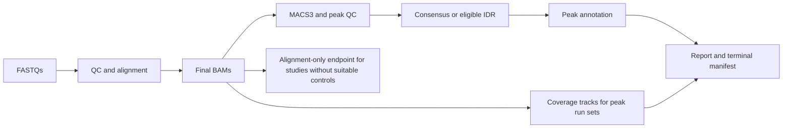

# *Schistosoma mansoni* ChIP-seq core preparation

## Scope of the preparation record

This record documents public-data preparation before scientific execution. It
does not change HelixForge, run analyses on the server, or promote results to
the atlas. The core uses the frozen `SM_V10/WBPS19` reference and the native
ChIP-seq contract of HelixForge [`v1.2.0`](https://github.com/GMiguelAlves/HelixForge/releases/tag/v1.2.0)
(`bd50fe094bc352f698feabe0ae0b8f0e777f5e97`), pinned specifically for this
ChIP-seq preparation in
[`execution_contract.json`](../../config/chipseq/execution_contract.json).
Historical RNA-seq release pins are unchanged.

The ENA inventory was rechecked. On October 12, 2026, WBPS19 remained the
latest version exposed by the official WormBase ParaSite directory. The
existing reference, checksums, and validation were reused; the ChIP-seq
package did not introduce another genome copy.

## Prepared studies

| Study | Scope | Raw FASTQ | Preparation decision |
|---|---:|---:|---|
| `PRJNA1173904` | 68 paired-end runs; eight gonadal marks | 130.77 GB | Q1/P1; peak calling with group-specific inputs |
| `PRJNA236156` | 60 single-end runs; four marks in cercariae/adults | 119.01 GB | Q1/P1; peak calling with input UB0 matched to each biological unit |
| `PRJNA312093` | 24 single-end runs; H3K4me3/H3K27me3 | 34.70 GB | Q1/P1; sex and life cycle, two replicates |
| `PRJNA602708` | 24 paired-end runs; H3K4me3/H3K27me3 | 13.73 GB | Q1/P1; plasma/treatment, two replicates |
| `PRJNA1090249` | Eight *S. mansoni* single-end runs; HP1 | 6.19 GB | Specialized Q1/P1; four *Drosophila* runs excluded |
| `PRJNA219440` | 29 mixed-layout runs; historical collection | 49.43 GB | Q2/P1; QC/alignment only |
| `PRJNA384372` | Three single-end H3K9ac runs | 0.47 GB | Q2/P2; QC/alignment only; publication linkage remains ambiguous |
| `PRJNA816041` | Eight paired-end ChIPmentation runs | 7.24 GB | Technical benchmark, outside the biological atlas |

For `PRJNA1173904`, the primary account identified during preparation was a
2026 preprint; a peer-reviewed gonadal-lncRNA study also reused the data. This
distinction is recorded in `publication_registry.tsv` and must remain explicit
in interpretation without changing the dataset's technical availability.

The so-called 108-library compendium combines `PRJNA236156` (60),
`PRJNA312093` (24), and `PRJNA602708` (24). It is not a ninth study: counting
it separately would duplicate FASTQs and evidence.

## Deposits not selected for execution

- `PRJEB23991`: eight paired-end libraries redundant with the
  miracidium/sporocyst subset of `PRJNA219440`. Biological sizes and deposited
  bases match, although ENA counts reads differently between deposits.
- `SRP007636`: four H3K9ac runs redeposited under `PRJNA384372` and
  `PRJNA219440`; the pairs are recorded in `duplicate_map.tsv`.
- `PRJEB3199`: two public runs without resolved mark, stage, control,
  replication, or publication. They do not meet the inclusion rule.

## Metadata reconstruction

The reconstruction does not invent groups. It maps public titles and aliases
to fields explicitly required by HelixForge: condition, biological replicate,
target, layout, control, and reference. Each library's original description
remains in `design.tsv` for audit.

The highest-impact decisions were:

- `PRJNA236156`: `Fa_1`, `Fb_2/Fb_4`, and `Fb_5/Fb_8` remain biological units;
  each IP points to its corresponding UB0.
- `PRJNA602708`: the generic input is shared by replicate number. “Beads
  without antibody” libraries are QC negative controls, not MACS3 controls.
- `PRJNA1173904`: A/A2 and B/B2 are normalized as replicates 1 and 2,
  respectively; each gonad/sexual-experiment group uses its public input.
- `PRJNA1090249`: only the eight *S. mansoni* runs are retained.
- `PRJNA219440`: two schistosomulum runs have unresolved targets in the
  deposit and retain that label. No run from this study advances to peak
  calling without a public control.

## HelixForge compatibility and frozen execution decisions

No structural pipeline change is required. Version 1.2.0 supports single-
and paired-end reads, Bowtie2, BAM processing, MACS3, FRiP, consensus/IDR,
annotation, and tracks. Because the API accepts one `peak_type` per invocation,
mixed-mark studies were split into `narrow` and `broad` run sets. This is an
execution configuration, not a pipeline fork.

Every IP is linked to its input/unbound control explicitly through
`control_id`; neither file order nor filenames are used to infer a control.
H3K4me3, H3K27ac, H3K9ac, H3K23ac, and H4K12ac follow the `narrow` path.
H3K27me3, H3K9me3, H3K36me3, H4K20me1, and HP1 follow the `broad` path.

Version 1.2.0 accepts a prebuilt Bowtie2 index together with its validated
manifest. Production requires that explicit bundle, using the version and
validation state recorded in the reference contract; missing inputs must not
silently trigger construction. Narrow and
broad invocations retain separate result directories, and index reuse must not
be confused with reuse of alignment tasks through Nextflow's cache.

### Composition without Differential Binding

The run modes in [`run_sets.tsv`](../../config/chipseq/run_sets.tsv) preserve
the biological design. Peak-producing runs use `consensus` or `idr` with
`--chipseq_postprocess true --chipseq_db_enabled false`. This completes peak
annotation, coverage tracks, the report, and the terminal manifest without
requiring a differential-binding contrast. Coverage uses final BAMs; annotation
uses the consolidated peaks.

Run sets registered as `post_alignment` remain QC/alignment-only. They do not
request peak calling, consensus/IDR, or the post-consensus outputs. In
particular, absence of public controls is not bypassed to obtain a report.

See the HelixForge [stage-composition guide](https://github.com/GMiguelAlves/HelixForge/blob/v1.2.0/docs/guides/chipseq-stage-composition.md)
for the runtime contracts. Atlas incorporation remains a separate review.

Frozen parameters and policies:

- Bowtie2 `--very-sensitive`;
- minimum MAPQ 30 and SAM exclusion flag 2308;
- duplicates retained in the analytical BAM and `MACS3 --keep-dup all`, per
  the validated HelixForge policy; duplication metrics remain mandatory;
- MACS3 3.0.4, `q=0.01`;
- initial effective size `391422299`, explicitly a proxy for total assembly
  length rather than an estimate of mappability;
- no blacklist: no validated, frozen *S. mansoni* blacklist was available.

## Limits on automatic inference

- Native trimming follows the registered [ChIP-seq reference and trimming
  policy](reference_and_trimming.md): Q20, minimum 25 bp, per-library adapter
  auto-detection and mandatory raw/post-trim QC review. No RNA-seq policy is
  implicitly inherited; two-colour poly-G artifacts require separate review.
- IDR applies only to exactly two biological narrowPeak replicates.
- Broad marks and three-replicate sets use consensus supported by at least
  two replicates.
- `PRJNA219440` and `PRJNA384372` produce descriptive QC/BAM outputs only;
  calling peaks without public inputs would be methodologically weak.
- Differential Binding is disabled in the initial peak-processing execution,
  not excluded from the study. Follow the [DB review and retention policy](differential_binding_review.md):
  review QC and model eligibility per study, preserve replicate BAMs/BAIs and
  metadata until the decision is resolved, and run eligible planned comparisons
  without waiting for the other studies. The HP1 cercaria/sporocyst candidate
  is registered before QC interpretation.

## Preparation batch policy

The acquisition batches describe up to 150 GB of raw FASTQ; they do not
authorize staging multiple studies concurrently. Heavy storage is occupied by
one study at a time. BAMs, indexes, tracks, and work directories count toward
the complete storage budget, and available capacity must be checked before
staging each study. Each run set keeps an independent result directory.
`PRJNA384372` remains an optional P2 batch.

## Project–atlas boundary

Results are reviewed study by study. Only peaks or consensus artifacts that
pass QC, have compatible reference identity, and carry complete provenance
may later enter the ChIP-seq atlas layer. Q2 BAMs, technical benchmarks, and
ambiguous deposits are not automatically included.
